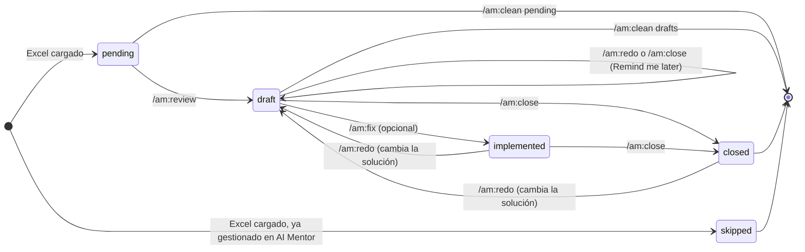

<div align="center">

# am

**Documenta hallazgos de AI Mentor (OutSystems) con Claude Code**

Un PDF formal y una guía paso a paso por cada hallazgo, sin que la IA toque tu aplicación.


[Instalación](#instalación) · [Inicio rápido](#inicio-rápido) · [Comandos](#comandos) · [Flujo](#flujo-de-trabajo) · [Salida](#qué-genera)

</div>

---

## Qué hace

AI Mentor exporta un Excel con los hallazgos de deuda técnica. `am` lo recorre **uno por uno** y, para cada hallazgo:

- lee el elemento afectado en OutSystems y encuentra la causa concreta;
- escribe una **guía `.md`** con los pasos exactos para corregirlo a mano en Service Studio;
- genera un **PDF de solución** con las seis secciones que suelen pedir los equipos de calidad;
- incluye siempre la alternativa de menor cambio, y te avisa cuando la solución cambia el comportamiento de la aplicación (**Requiere decisión funcional**);
- separa lo que encuentra de otra categoría (seguridad, datos, bugs) como observaciones fuera del alcance, para que lo reportes aparte;
- te sugiere qué estado darle en AI Mentor (Open, Already fixed, False positive, Won't fix o Remind me later), con una justificación;
- se detiene y te pregunta antes de pasar al siguiente.

Tú aplicas la corrección, guardas los pantallazos, cambias el estado en AI Mentor y cierras el hallazgo con un comando.

## Instalación

Dentro de Claude Code:

```
/plugin marketplace add nuki23/am-plugin
/plugin install am@nuki23
```

Para traer una versión nueva:

```
/plugin marketplace update nuki23
```

### Requisitos

| Necesitas | Para qué |
|---|---|
| Claude Code con una conexión a OutSystems | Leer módulos, pantallas, acciones y aggregates |
| Python 3 **o** Node.js | Generar los PDF (el plugin usa el que encuentre) |
| El Excel "Code Quality Report" de AI Mentor | Lista de hallazgos a trabajar |

> Sin Python ni Node, el plugin genera las guías `.md` y deja el PDF pendiente; nunca instala un lenguaje por su cuenta.

## Inicio rápido

```
/am:review reporte.xlsx      # analiza y documenta, un hallazgo a la vez
                             # ...aplicas la corrección en Service Studio...
/am:close SRC-003            # genera el PDF final con tu evidencia
/am:summary                  # resumen de la semana
```

## Comandos

| Comando | Qué hace | Escribe en OutSystems |
|---|---|:---:|
| `/am:review [excel]` | Carga el Excel y documenta los hallazgos uno a uno. Sin argumento, continúa donde quedó. | No |
| `/am:close <ID>` | Cierra un hallazgo con su estado final (ver abajo). Con **Remind me later** no cierra: anota el motivo y lo deja como estaba. | No |
| `/am:redo <ID> [nota]` | Rehace el análisis de un hallazgo cuando algo salió mal. | No |
| `/am:status` | Muestra el avance por estado y por módulo, y lista aparte los hallazgos que requieren consulta. | No |
| `/am:summary [desde]` | Genera el reporte resumen del periodo (últimos 7 días por defecto). | No |
| `/am:clean [pending\|drafts\|all]` | Archiva pendientes, borradores o todo `reports/` en `reports/_archive/<fecha>/`. Nunca borra; lista lo que va a mover y espera tu sí. `all` exige escribir `ARCHIVAR TODO`. | No |
| `/am:fix <ID>` | *Opcional.* Implementa la solución ya documentada. Requiere conexión con escritura. | **Sí** |

### Estados finales

`/am:close` acepta estos estados, con el mismo vocabulario de AI Mentor. El plugin nunca cambia el estado en AI Mentor: solo lo recomienda.

| Estado final | Qué exige |
|---|---|
| `Fixed` | Corrección aplicada; pantallazos en `evidence/` |
| `Already fixed` | El problema ya no existe en el código; pantallazos en `evidence/` |
| `False positive` | Justificación escrita y quién aprobó la decisión |
| `Won't fix` | Justificación escrita y quién aprobó la decisión |

## Flujo de trabajo



| Estado | Significa |
|---|---|
| `pending` | Está en el Excel y aún no se analiza |
| `draft` | Tiene guía y PDF en borrador; falta corregirlo o decidir |
| `implemented` | La corrección se aplicó con `/am:fix`; falta validar y cerrar |
| `closed` | Fixed, Already fixed, False positive o Won't fix, con PDF final |
| `skipped` | Ya venía gestionado en AI Mentor (se guarda su motivo) |

`/am:clean all` archiva todo, sin importar el estado, para empezar con un Excel nuevo.

> Después de `/am:clean pending` o `/am:clean drafts`, si vuelves a cargar un Excel donde esos hallazgos sigan en `Open`, reaparecen como `pending`, con un ID nuevo.

## Qué genera

Todo queda en la carpeta donde ejecutas Claude Code:

```
reports/
├── _progress.md                  avance de todos los hallazgos
├── _summaries/                   summary-<fecha>.md y .pdf de /am:summary
├── _archive/<fecha>/             lo que movió /am:clean
└── <Module>/
    └── <ID>-<Object Name>/
        ├── solution.md                                  guía para corregirlo a mano
        ├── <Module>-<Parent>-<Object Name>-<Prefix>.pdf documento formal
        ├── implementation.md                            solo si usaste /am:fix
        └── evidence/                                    tus pantallazos
scripts/
└── generate_pdf.py | .mjs        se crea una vez y se reutiliza
```

Los nombres de archivos y carpetas van en inglés; el contenido de los documentos, en español. El PDF lleva el elemento padre del `Object Path` (la pantalla o el flujo que contiene al objeto) y se llama, por ejemplo, `Ventas-PedidoDetalle-ValidarPedido-SRC.pdf`: se limpian los caracteres no válidos y, si dos nombres chocan, se agrega un sufijo numérico. Si el objeto no tiene padre distinto del módulo, el nombre queda `<Module>-<Object Name>-<Prefix>.pdf`.

### La guía `solution.md`

Además de los pasos manuales, la guía trae:

- **Consultar antes de implementar**, solo cuando hay algo que consultar: un cambio de comportamiento, observaciones fuera del alcance, una alternativa que depende de algo fuera del módulo, o puntos no verificados que no puedes confirmar solo. Va al inicio, justo después del estado sugerido, como una lista corta de preguntas listas para copiar, sin mencionar personas, roles ni equipos. En el chat el hallazgo sale como **Requiere consulta**, con el número de puntos, y `/am:status` lista aparte los hallazgos que lo tienen. No va en el PDF.
- **Alternativas consideradas**, siempre con la *alternativa mínima*: la opción de menor cambio que elimina el patrón sin alterar el comportamiento actual, aunque no sea la recomendada. Si el código hoy no tiene efecto, "retirarlo" aparece entre las alternativas, con lo que habría que confirmar antes. Antes de proponer consumir un REST de otro módulo del mismo ambiente, el plugin considera referenciar una Server Action o Service Action de ese módulo.
- **Cambio de comportamiento**, solo cuando la solución hace algo más que eliminar el patrón (arregla un bug, activa lógica que hoy no se ejecuta, cambia datos que se escriben o borran, crea integraciones). El hallazgo queda marcado como **Requiere decisión funcional** en el chat y `/am:fix` no lo implementa sin que confirmes que la decisión se tomó.
- **Hallazgos relacionados**, solo cuando otro hallazgo del progreso toca el mismo elemento, tema o acción compartida. Se identifican por pantalla y patrón (el ID solo se menciona en el chat) y la guía indica si conviene corregirlos juntos para publicar una sola vez.
- **Observaciones fuera del alcance**, solo cuando el análisis encuentra algo de otra categoría (seguridad, datos, un bug). Se destacan en el chat para que las reportes aparte; el PDF solo dice, en una línea, que se reportan por separado. Al cerrar, `/am:close` te pregunta si ya las reportaste, y solo entonces el PDF final lo dice en pasado.

### El PDF de solución

El título es `<Parent> > <Object Name>` (por ejemplo, "PedidoDetalle > ValidarPedido"), en la fuente normal de los títulos. En el resto del documento, los identificadores (clases CSS, nombres de acciones, rutas) van en fuente monoespaciada y no se parten al final de la línea. Siempre con estas seis secciones:

1. Identificación del hallazgo (App, Module, Category, Pattern Name, Object Name, Object Type, Object Path y Fecha de análisis, con esas etiquetas y en ese orden)
2. Módulo afectado
3. Descripción de la causa identificada
4. Solución aplicada
5. Evidencia de corrección
6. Estado final de la atención

Mientras el hallazgo está en `draft`, el PDF sale marcado como **BORRADOR**, la sección 4 se titula "Solución propuesta" y las secciones 5 y 6 quedan pendientes. Si la solución cambia el comportamiento, la sección 4 lleva un apartado "Cambio de comportamiento". `/am:close` genera la versión final; si el hallazgo pasó por `/am:fix` y se cierra sin `Fixed`, la sección 6 indica si ese cambio fue revertido o sigue en OutSystems. Ni el PDF ni `solution.md` incluyen el ID interno ni el estado sugerido en AI Mentor.

### Identificadores

El Excel de AI Mentor no trae ID, así que el plugin asigna uno corto por patrón: prefijo de 3 letras + consecutivo (por ejemplo, `SRC-003`). Es un ID interno: aparece en `_progress.md`, en el nombre de la carpeta y en el chat (es el argumento de `/am:close`, `/am:redo` y `/am:fix`), pero no en los documentos que se entregan. El patrón se busca por nombre, sin distinguir mayúsculas ni espacios extra.

<details>
<summary>Ver los 44 prefijos predefinidos</summary>

| Prefijo | Patrón |
|---|---|
| `AGR` | Automatically generated publicly exposed REST endpoint |
| `AQC` | Aggregate or SQL query inside a cycle |
| `ARS` | Avoid setting Anonymous Roles to access Screens |
| `CDE` | Consuming Deprecated Element |
| `CMF` | Core module consumed by Foundation |
| `CRA` | Cyclic references between applications |
| `CSS` | CSS in the screen's style sheet |
| `DUP` | Duplicated Code |
| `EAS` | End-User application providing services |
| `EMS` | End-User module providing services |
| `ERS` | Exposed REST services are not secured |
| `ESP` | Exposed Secrets in Site Properties |
| `FCS` | Foundation or Core module with screens |
| `ICS` | Inline CSS style |
| `IEL` | Inefficient empty list test |
| `IGU` | Insecure usage of GetUserId function on client context |
| `LIM` | Large image |
| `LLV` | Large Local Variable in ViewState |
| `LRE` | Large resource |
| `LRT` | Avoid long-running Timers |
| `LST` | Long Server Requests Timeout |
| `LSV` | Large Session Variable |
| `LUF` | Long undocumented flow |
| `MDP` | Missing descriptions on public element or parameter |
| `MSM` | Monolithic Service Module |
| `MSR` | Multiple server requests (Aggregates or actions) inside Client Actions |
| `MUI` | Monolithic web UI module |
| `PER` | Public Entities aren't read-only |
| `REM` | Reminder Comments |
| `RRS` | Avoid setting Registered Roles to access Screens |
| `SCA` | Sequence of connected Aggregates |
| `SEA` | Screen Aggregate exposing System entities on Anonymous screen |
| `SER` | Screen Aggregate exposing System entities on Registered screen |
| `SPU` | Site Property update |
| `SQI` | Vulnerable SQL Injection |
| `SRC` | Server requests in client events |
| `TDC` | Too much disabled code |
| `TSC` | Team strongly coupled with another team |
| `UAM` | Unused Action in Module |
| `UAQ` | Unused Aggregate or SQL Query |
| `ULO` | Unreachable Logic |
| `UPT` | Unidentified public action managing transaction |
| `URA` | Unlimited records in Aggregate |
| `URS` | Unlimited records in SQL query |

</details>

Si un patrón no está en la tabla, el plugin genera un prefijo de 3 letras que no choque con los existentes y lo registra en la sección `Prefixes` de `_progress.md`. Los ID ya asignados en un `_progress.md` existente no cambian. La sección `Prefixes` guarda además el último consecutivo de cada prefijo (columna `Last`), así que un ID nunca se reutiliza, ni siquiera después de `/am:clean` (con `all`, el `_progress.md` nuevo conserva esa sección).

## Garantías de diseño

- **Solo lectura por defecto.** Seis de los siete comandos nunca publican ni editan en OutSystems.
- **AI Mentor lo cambias tú.** El plugin recomienda un estado, pero nunca lo cambia, y no sugiere False positive ni Won't fix sin explicar qué verificó en el código.
- **Nunca borra.** `/am:clean` siempre archiva en `reports/_archive/`.
- **Un hallazgo a la vez.** El plugin se detiene y pregunta antes de continuar.
- **Sin invenciones.** Lo que no se pudo leer en OutSystems queda marcado como "No verificado", y el PDF nunca afirma algo con más certeza que la guía: si allí dice "no verificado" o "probable", el PDF usa la misma cautela.
- **Sin secretos ni datos personales.** Ningún `.md`, PDF ni mensaje en el chat copia el valor de un secreto, credencial, token o dato personal; solo el nombre y la ruta del elemento.
- **Implementado no es validado.** Ningún documento afirma que algo fue corregido sin tu confirmación.

### Sobre `/am:fix`

Es el único comando que modifica OutSystems, y solo lo ejecutas tú. Antes de tocar nada comprueba que la conexión permita escritura, que el ambiente sea Desarrollo y que el análisis siga vigente. Si el hallazgo está marcado como **Requiere decisión funcional**, se niega a implementarlo hasta que confirmes, en esa misma invocación, que la decisión se tomó. Por separado, si la guía tiene "Consultar antes de implementar", te muestra las preguntas y se detiene hasta que confirmes que ya se resolvieron. Luego te muestra el plan de cambio y espera tu confirmación. Con una conexión de solo lectura, simplemente te avisa y termina.

## Privacidad

`reports/` contiene información de tu aplicación. Trabaja en una carpeta distinta a este repositorio y no la subas a un repo público.
