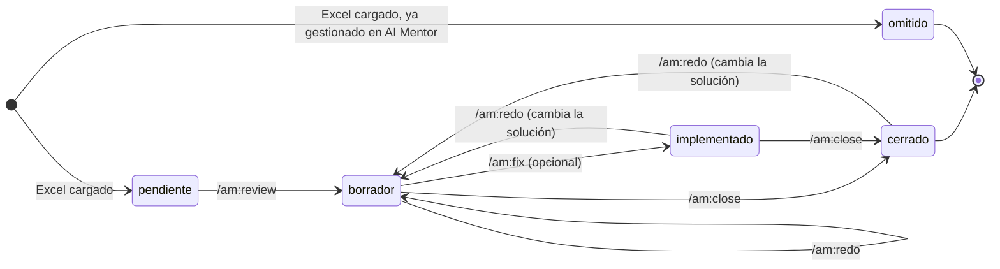

<div align="center">

# am

**Documenta hallazgos de AI Mentor (OutSystems) con Claude Code**

Un PDF formal y una guía paso a paso por cada hallazgo, sin que la IA toque tu aplicación.


[Instalación](#instalación) · [Inicio rápido](#inicio-rápido) · [Comandos](#comandos) · [Flujo](#flujo-de-trabajo) · [Salida](#qué-genera)

</div>

---

## Qué hace

AI Mentor exporta un Excel con los hallazgos de deuda técnica. `am` lo recorre **uno por uno** y, para cada hallazgo:

- lee el elemento afectado en OutSystems y encuentra la causa concreta;
- escribe una **guía `.md`** con los pasos exactos para corregirlo a mano en Service Studio;
- genera un **PDF de solución** con las seis secciones que suelen pedir los equipos de calidad;
- se detiene y te pregunta antes de pasar al siguiente.

Tú aplicas la corrección, guardas los pantallazos y cierras el hallazgo con un comando.

## Instalación

Dentro de Claude Code:

```
/plugin marketplace add nuki23/am-plugin
/plugin install am@nuki23
```

Para traer una versión nueva:

```
/plugin marketplace update nuki23
```

### Requisitos

| Necesitas | Para qué |
|---|---|
| Claude Code con una conexión a OutSystems | Leer módulos, pantallas, acciones y aggregates |
| Python 3 **o** Node.js | Generar los PDF (el plugin usa el que encuentre) |
| El Excel "Code Quality Report" de AI Mentor | Lista de hallazgos a trabajar |

> Sin Python ni Node, el plugin genera las guías `.md` y deja el PDF pendiente; nunca instala un lenguaje por su cuenta.

## Inicio rápido

```
/am:review reporte.xlsx      # analiza y documenta, un hallazgo a la vez
                             # ...aplicas la corrección en Service Studio...
/am:close SRC-003            # genera el PDF final con tu evidencia
/am:summary                  # resumen de la semana
```

## Comandos

| Comando | Qué hace | Escribe en OutSystems |
|---|---|:---:|
| `/am:review [excel]` | Carga el Excel y documenta los hallazgos uno a uno. Sin argumento, continúa donde quedó. | No |
| `/am:close <ID>` | Cierra un hallazgo como **Resuelto** (con evidencia) o **Won't fix** (con justificación escrita y quién aprobó la decisión). | No |
| `/am:redo <ID> [nota]` | Rehace el análisis de un hallazgo cuando algo salió mal. | No |
| `/am:status` | Muestra el avance por estado y por módulo. | No |
| `/am:summary [desde]` | Genera el reporte resumen del periodo (últimos 7 días por defecto). | No |
| `/am:fix <ID>` | *Opcional.* Implementa la solución ya documentada. Requiere conexión con escritura. | **Sí** |

## Flujo de trabajo



| Estado | Significa |
|---|---|
| `pendiente` | Está en el Excel y aún no se analiza |
| `borrador` | Tiene guía y PDF en borrador; falta corregirlo |
| `implementado` | La corrección se aplicó con `/am:fix`; falta validar y cerrar |
| `cerrado` | Resuelto o Won't fix, con PDF final |
| `omitido` | Ya venía gestionado en AI Mentor |

## Qué genera

Todo queda en la carpeta donde ejecutas Claude Code:

```
reportes/
├── _progreso.md                  avance de todos los hallazgos
├── _resumenes/                   reportes de /am:summary
└── <Módulo>/
    └── <ID>-<Elemento>/
        ├── solucion.md           guía para corregirlo a mano
        ├── solucion.pdf          documento formal
        ├── implementacion.md     solo si usaste /am:fix
        └── evidencia/            tus pantallazos
scripts/
└── generar_pdf.py | .mjs         se crea una vez y se reutiliza
```

### El PDF de solución

Siempre con estas seis secciones:

1. Identificación del hallazgo
2. Módulo afectado
3. Descripción de la causa identificada
4. Solución aplicada
5. Evidencia de corrección
6. Estado final de la atención

Mientras el hallazgo está en `borrador`, el PDF sale marcado como **BORRADOR**, la sección 4 se titula "Solución propuesta" y las secciones 5 y 6 quedan pendientes. `/am:close` genera la versión final.

### Identificadores

El Excel de AI Mentor no trae ID, así que el plugin asigna uno corto por patrón: prefijo de 3 letras + consecutivo (por ejemplo, `SRC-003`). El patrón se busca por nombre, sin distinguir mayúsculas ni espacios extra.

<details>
<summary>Ver los 44 prefijos predefinidos</summary>

| Prefijo | Patrón |
|---|---|
| `AGR` | Automatically generated publicly exposed REST endpoint |
| `AQC` | Aggregate or SQL query inside a cycle |
| `ARS` | Avoid setting Anonymous Roles to access Screens |
| `CDE` | Consuming Deprecated Element |
| `CMF` | Core module consumed by Foundation |
| `CRA` | Cyclic references between applications |
| `CSS` | CSS in the screen's style sheet |
| `DUP` | Duplicated Code |
| `EAS` | End-User application providing services |
| `EMS` | End-User module providing services |
| `ERS` | Exposed REST services are not secured |
| `ESP` | Exposed Secrets in Site Properties |
| `FCS` | Foundation or Core module with screens |
| `ICS` | Inline CSS style |
| `IEL` | Inefficient empty list test |
| `IGU` | Insecure usage of GetUserId function on client context |
| `LIM` | Large image |
| `LLV` | Large Local Variable in ViewState |
| `LRE` | Large resource |
| `LRT` | Avoid long-running Timers |
| `LST` | Long Server Requests Timeout |
| `LSV` | Large Session Variable |
| `LUF` | Long undocumented flow |
| `MDP` | Missing descriptions on public element or parameter |
| `MSM` | Monolithic Service Module |
| `MSR` | Multiple server requests (Aggregates or actions) inside Client Actions |
| `MUI` | Monolithic web UI module |
| `PER` | Public Entities aren't read-only |
| `REM` | Reminder Comments |
| `RRS` | Avoid setting Registered Roles to access Screens |
| `SCA` | Sequence of connected Aggregates |
| `SEA` | Screen Aggregate exposing System entities on Anonymous screen |
| `SER` | Screen Aggregate exposing System entities on Registered screen |
| `SPU` | Site Property update |
| `SQI` | Vulnerable SQL Injection |
| `SRC` | Server requests in client events |
| `TDC` | Too much disabled code |
| `TSC` | Team strongly coupled with another team |
| `UAM` | Unused Action in Module |
| `UAQ` | Unused Aggregate or SQL Query |
| `ULO` | Unreachable Logic |
| `UPT` | Unidentified public action managing transaction |
| `URA` | Unlimited records in Aggregate |
| `URS` | Unlimited records in SQL query |

</details>

Si un patrón no está en la tabla, el plugin genera un prefijo de 3 letras que no choque con los existentes y lo registra en la sección `Prefijos` de `_progreso.md`. Los ID ya asignados en un `_progreso.md` existente no cambian.

## Garantías de diseño

- **Solo lectura por defecto.** Cinco de los seis comandos nunca publican, editan ni cambian estados en OutSystems.
- **Un hallazgo a la vez.** El plugin se detiene y pregunta antes de continuar.
- **Sin invenciones.** Lo que no se pudo leer en OutSystems queda marcado como "No verificado".
- **Sin secretos ni datos personales.** Ningún `.md`, PDF ni mensaje en el chat copia el valor de un secreto, credencial, token o dato personal; solo el nombre y la ruta del elemento.
- **Implementado no es validado.** Ningún documento afirma que algo fue corregido sin tu confirmación.

### Sobre `/am:fix`

Es el único comando que modifica OutSystems, y solo lo ejecutas tú. Antes de tocar nada comprueba que la conexión permita escritura, que el ambiente sea Desarrollo y que el análisis siga vigente; luego te muestra el plan de cambio y espera tu confirmación. Con una conexión de solo lectura, simplemente te avisa y termina.

## Privacidad

`reportes/` contiene información de tu aplicación. Trabaja en una carpeta distinta a este repositorio y no la subas a un repo público.
